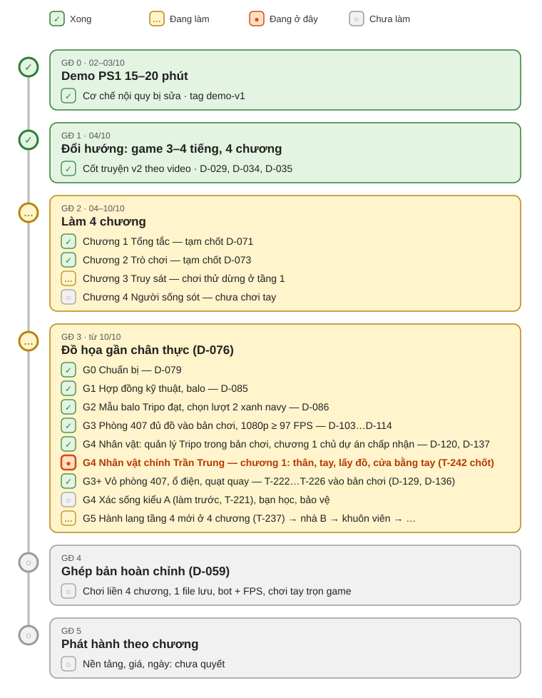

# Bản đồ lộ trình — "Ký túc xá sau 12 giờ"

> **Cập nhật:** 2026-11-12 (sau D-160: thân Trần Trung vào chương 1 với tay, lấy đồ, mở cửa bằng tay T-239/T-241/T-242; hành lang tầng 4 mới ở 4 chương T-237; lane HARU điều phối phụ). Integrator cập nhật file này **mỗi khi qua một mốc** (chốt chương, đóng cổng G, đổi hướng lớn).
> Chi tiết từng ngày: `docs/STATUS.md`. Lý do từng quyết định: `docs/DECISIONS.md` (D-001…D-160).
> Ký hiệu: ✅ xong · 🔶 đang làm · ⬜ chưa bắt đầu · 📍 **đang ở đây**

## 1. Bản đồ tổng



(Ảnh `docs/roadmap.svg` sinh bằng `python docs/build_roadmap_svg.py`: sửa danh sách `phases` trong script rồi chạy lại khi cập nhật file này. Script cũng ghi lại mục 1 của file này.)

Bản chữ (xem được trong terminal / Notepad):

```text
[✅] GĐ 0  Demo PS1 (02–03/10) ............................ tag demo-v1
  │
[✅] GĐ 1  Đổi hướng: 4 chương, cốt truyện v2 (04/10) ...... D-029, D-034
  │
[🔶] GĐ 2  Làm 4 chương (04–10/10)
  │     ├─ [✅] Chương 1 Tổng tắc ........................ tạm chốt D-071
  │     ├─ [✅] Chương 2 Trò chơi ........................ tạm chốt D-073
  │     ├─ [🔶] Chương 3 Truy sát ........................ chơi thử dừng ở tầng 1
  │     └─ [⬜] Chương 4 Người sống sót .................. chưa chơi tay
  │
[🔶] GĐ 3  Đồ họa gần chân thực (từ 10/10, D-076)
  │     ├─ [✅] G0 Chuẩn bị .............................. D-079
  │     ├─ [✅] G1 Hợp đồng kỹ thuật (balo) .............. D-085
  │     ├─ [✅] G2 Mẫu balo Tripo, chọn lượt 2 ............ D-086
  │     ├─ [✅] G3 Phòng 407 đủ đồ vào bản chơi .......... D-103…D-114
  │     ├─ [✅] G4 Nhân vật: quản lý Tripo ............... D-120, chương 1 chủ dự án chấp nhận (D-137)
  │     ├─ [✅] G3+ Vỏ phòng 407, ổ điện, quạt quay ...... T-222…T-226 (D-129, D-136)
  │     ├─ [📍] G4 Nhân vật chính Trần Trung (Tripo) ..... ĐANG Ở ĐÂY: thân vào chương 1 (D-151), tay/lấy đồ duyệt (D-157), cửa bằng tay T-242 chủ dự án chốt; chương 2–4 chưa có thân
  │     ├─ [⬜] G4 Xác sống (trước), bạn học, bảo vệ ...... D-122 kiểu A, card T-221, chờ mẫu m1
  │     └─ [🔶] G5 Hành lang tầng 4 mới ở 4 chương (T-237) → nhà B → khuôn viên → thư viện/bệnh viện
  │
[⬜] GĐ 4  Ghép bản hoàn chỉnh: chơi liền 4 chương, 1 file lưu (D-059)
  │
[⬜] GĐ 5  Phát hành theo chương
```

## 2. Từng giai đoạn

### Giai đoạn 0 — Demo PS1 (02–03/10) ✅
- Godot 4.7.2, đồ họa PS1, cơ chế "nội quy có bản bị sửa", 5 lane agent + integrator (D-001…D-028).
- Kết quả: demo 15–20 phút, tag `demo-v1` (bản chơi lưu ở `build/archive/demo-v1/`).

### Giai đoạn 1 — Đổi hướng thành game đầy đủ (04/10) ✅
- D-029: game 3–4 tiếng, **4 chương**, mỗi chương một đêm.
- D-034/D-035: cốt truyện chuyển thể video "Quy tắc kí túc xá lúc nửa đêm"; nhân vật Trần Trung (407), Lý Minh Nhật, Khương Ngọc Ngư. Thiết kế: `docs/design/STORY.md`.

### Giai đoạn 2 — Làm 4 chương (04–10/10)
| Chương | Đã làm | Chơi tay | Tình trạng |
|---|---|---|---|
| 1 Tổng tắc | Bản 1 (`v0.2-ch1`), bản 2 tám nhiệm vụ (`v0.3-ch1`), sửa giường/quản lý/gõ tường (D-069, D-070) | ✅ | **Tạm chốt D-071.** Phòng 407 mới (G3) đã chơi, 3 lỗi sửa ở D-113 |
| 2 Trò chơi | Nối từ gõ phím + từ điển Wiktionary (D-051), tắm/nhiệt độ, `v0.4-ch2`, nhắn cách qua màn (D-072) | ✅ trừ đoạn nhắn tin D-072 | **Tạm chốt D-073.** Nhà tắm mới (D-109) chờ chơi lại |
| 3 Truy sát | Khuôn viên gần kích thước thật, xác sống, thanh sắt, đồng đội đi theo; sửa D-061…D-065, D-074, D-075 | 🔶 tới tầng 1 nhà B | **Chờ chủ dự án chơi tiếp từ tầng 1** |
| 4 Người sống sót | Đối chiếu, gọi điện, bệnh viện, kết thúc; lồng tiếng (D-067, D-068) | ⬜ | **Chờ chủ dự án chơi lần đầu** |

Bản chơi hiện hành: `build/windows/KyTucXa.exe` **12/11 00:01** (main `780ed57`, sau T-242). Phiếu chơi thử: `docs/playtest/G3_PHONG407_QUICKTEST.md`.

### Giai đoạn 3 — Đồ họa gần chân thực (từ 10/10, D-076) 📍
Mục tiêu: hình gần thật, 1080p/60 FPS trên RTX 3050 Laptop. Đồ vật tạo bằng **Tripo AI** (gói Studio Pro, D-080/D-084), chỉnh trong Blender, đưa vào Godot. Kế hoạch: `docs/design/GRAPHICS_UPGRADE_PLAN.md`.

| Cổng | Nội dung | Tình trạng |
|---|---|---|
| G0 Chuẩn bị | 6 gói việc T-207…T-212 khảo sát, đo, công cụ | ✅ D-079 |
| G1 Hợp đồng kỹ thuật | Công cụ kiểm asset, hồ sơ balo, giấy phép Tripo (D-084) | ✅ D-085 |
| G2 Thử Tripo | Balo Tripo lượt 2 xanh navy | ✅ D-086 |
| G3 Phòng 407 vào bản chơi | Tripo 3 đợt (70 món) + mùng, chiếu, gạch, decal bằng Blender (D-089…D-101) → vào bản chơi cả 4 chương (D-103) → ánh sáng (D-104), gương phản chiếu thật (D-105), giấy và dây điện (D-106), sửa nhà tắm (D-109), khung đọc ảnh/thẻ (D-112), sửa 3 lỗi chủ dự án báo + phòng tối hẳn (D-113). **1080p thấp nhất 97,7 FPS (D-114).** Bộ lọc PS1 mặc định tắt | ✅ chủ dự án duyệt độ tối và hết lỗi |
| **G4 Nhân vật** | **Quản lý trước** (D-115): nam ~45 tuổi, đồng phục quản lý trường học, mặt kinh dị, dao phay. Lane C làm thử mẫu MPFB (D-117) nhưng chủ dự án chọn bỏ; **chủ dự án tự làm, integrator hỗ trợ** (D-118). Phiếu Tripo `docs/handoff/TRIPO_QUAN_LY.md`; bài học kỹ thuật trong card T-219. Tripo: thân, 6 động tác, dao, chìa khóa, thẻ (D-119); chủ dự án duyệt, mắt trắng đục, vào bản chơi chương 1 và gương chương 2 (D-120) | 📍 **chờ chơi thử** |
| G4 tiếp | Nhân vật chính có thân và tay cầm nắm, mở cửa như thật; nhân vật khác đi không trượt chân; xác sống, 2 bạn học, bảo vệ | 📍 Trần Trung trong chương 1: thân Tripo (T-227, D-151), sửa tay T-239, lấy đồ tự nhiên T-241 (chủ dự án duyệt 11/11), cửa nhà tắm/ban công bằng tay T-242 (chủ dự án chốt 12/11). Chương 2–4 chưa có thân. Xác sống T-221 chờ mẫu m1 |
| G5 Mở rộng cảnh | Hành lang tầng 4 → nhà B → khuôn viên → thư viện/bệnh viện | 🔶 hành lang tầng 4 mới ở 4 chương (T-237, 09/11); bên trong phòng khác, cầu thang, nhà vệ sinh chung để sau |

### Giai đoạn 4 — Ghép bản hoàn chỉnh (D-059) ⬜
Khoảng 4–6 ngày: hết chương tự sang chương sau, **một file lưu xuyên suốt**, đồng bộ đồ họa giữa các chương, ánh sáng 4 giờ → 9 giờ, rà chi tiết liền mạch (đồ đạc, xác, chat, ai sống), bot cả 4 chương, đo FPS, chơi tay trọn game. Thứ tự so với G4/G5 do chủ dự án chốt khi tới.

### Giai đoạn 5 — Phát hành ⬜
Phát hành theo chương (D-029). Nền tảng, giá, ngày: chưa quyết. Steam yêu cầu khai báo nội dung AI (`AGENTS.md` §5).

## 3. Việc đang chờ chủ dự án (để tiếp tục)
1. 📍 **Chọn việc tiếp theo:** integrator đề xuất thân Trần Trung cho chương 2, kèm tiếng cửa (lane E).
2. **Xác sống (T-221, D-122):** tạo m1 (Phúc) theo `docs/handoff/TRIPO_XAC_SONG.md`, tải về `build/graphics/staging/zombie/`.
3. **Chơi thử chương 2–4** với đồ họa mới (chương 3 từ tầng 1, chương 4 lần đầu).
4. **Thân Trần Trung cho chương 2–4:** chủ dự án chọn lúc nào làm (sau khi chơi T-242).
5. **Học làm động tác (tùy chọn):** integrator soạn trang hướng dẫn Blender cho người mới khi chủ dự án muốn.

## 4. Đội làm
- **Integrator:** Claude Code ở máy (Opus 5.5, có lúc Fable 5.2). **HARU** (D-160): tài khoản Claude khác, làm thay khi integrator hết hạn mức.
- **Lane (D-141):** A gameplay và C QA/công cụ: tài khoản GPT, Codex CLI trên máy này (việc T-231, T-232). B môi trường/3D: **tài khoản Claude, Claude Code trên máy này**. E âm thanh: tài khoản GPT từng làm B. D giao diện/đa ngôn ngữ: Gemini 3.8 Flash (D-108), rảnh. F (Claude Code web): dừng.
