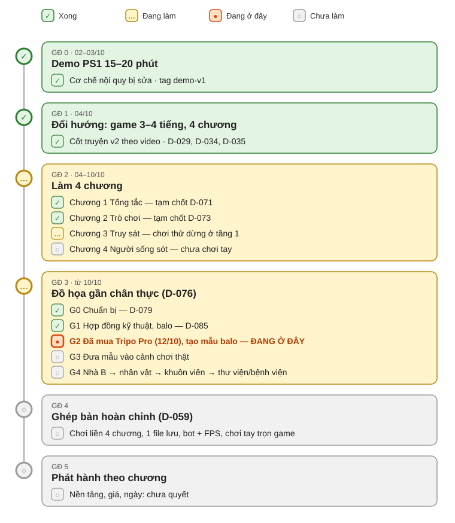

# Bản đồ lộ trình — "Ký túc xá sau 12 giờ"

> **Cập nhật:** 2026-10-13 (sau D-096: Tripo đợt 2 xong, phòng 407 đủ đồ trong cảnh làm thử). Integrator cập nhật file này **mỗi khi qua một mốc** (chốt chương, đóng cổng G, đổi hướng lớn).
> Chi tiết từng ngày: `docs/STATUS.md`. Lý do từng quyết định: `docs/DECISIONS.md` (D-001…D-090).
> Ký hiệu: ✅ xong · 🔶 đang làm · ⬜ chưa bắt đầu · 📍 **đang ở đây**

## 1. Bản đồ tổng



(Ảnh `docs/roadmap.svg` sinh bằng `python docs/build_roadmap_svg.py`: sửa danh sách `phases` trong script rồi chạy lại khi cập nhật file này. Script cũng ghi lại mục 1 của file này.)

Bản chữ (xem được trong terminal / Notepad):

```text
[✅] GĐ 0  Demo PS1 (02–03/10) ............................ tag demo-v1
  │
[✅] GĐ 1  Đổi hướng: 4 chương, cốt truyện v2 (04/10) ...... D-029, D-034
  │
[🔶] GĐ 2  Làm 4 chương (04–10/10)
  │     ├─ [✅] Chương 1 Tổng tắc ........................ tạm chốt D-071
  │     ├─ [✅] Chương 2 Trò chơi ........................ tạm chốt D-073
  │     ├─ [🔶] Chương 3 Truy sát ........................ chơi thử dừng ở tầng 1
  │     └─ [⬜] Chương 4 Người sống sót .................. chưa chơi tay
  │
[🔶] GĐ 3  Đồ họa gần chân thực (từ 10/10, D-076)
  │     ├─ [✅] G0 Chuẩn bị .............................. D-079
  │     ├─ [✅] G1 Hợp đồng kỹ thuật (balo) .............. D-085
  │     ├─ [✅] G2 Mẫu balo Tripo, chọn lượt 2 ............ D-086
  │     ├─ [📍] G3 Đưa mẫu vào cảnh chơi thật ............ ĐANG Ở ĐÂY (chờ quyết)
  │     └─ [⬜] G4 Nhà B → nhân vật → khuôn viên → thư viện/bệnh viện
  │
[⬜] GĐ 4  Ghép bản hoàn chỉnh: chơi liền 4 chương, 1 file lưu (D-059)
  │
[⬜] GĐ 5  Phát hành theo chương
```

## 2. Từng giai đoạn

### Giai đoạn 0 — Demo PS1 (02–03/10) ✅
- Godot 4.7.2, đồ họa PS1, cơ chế "nội quy có bản bị sửa", 5 lane agent + integrator (D-001…D-028).
- Kết quả: demo 15–20 phút, tag `demo-v1` (bản chơi lưu ở `build/archive/demo-v1/`).

### Giai đoạn 1 — Đổi hướng thành game đầy đủ (04/10) ✅
- D-029: game 3–4 tiếng, **4 chương**, mỗi chương một đêm.
- D-034/D-035: cốt truyện chuyển thể video "Quy tắc kí túc xá lúc nửa đêm"; nhân vật Trần Trung (407), Lý Minh Nhật, Khương Ngọc Ngư. Thiết kế: `docs/design/STORY.md`.

### Giai đoạn 2 — Làm 4 chương (04–10/10)
| Chương | Đã làm | Chơi tay | Tình trạng |
|---|---|---|---|
| 1 Tổng tắc | Bản 1 (`v0.2-ch1`), bản 2 tám nhiệm vụ (`v0.3-ch1`), sửa giường/quản lý/gõ tường (D-069, D-070) | ✅ | **Tạm chốt D-071** |
| 2 Trò chơi | Nối từ gõ phím + từ điển Wiktionary (D-051), tắm/nhiệt độ, `v0.4-ch2`, nhắn cách qua màn (D-072) | ✅ trừ đoạn nhắn tin D-072 | **Tạm chốt D-073** |
| 3 Truy sát | Khuôn viên gần kích thước thật, xác sống, thanh sắt, đồng đội đi theo; sửa D-061…D-065, D-074, D-075 | 🔶 tới tầng 1 nhà B | **Chờ chủ dự án chơi tiếp từ tầng 1** (`docs/playtest/CH3_QUICKTEST.md` bước 6) |
| 4 Người sống sót | Đối chiếu, gọi điện, bệnh viện, kết thúc; lồng tiếng (D-067, D-068) | ⬜ | **Chờ chủ dự án chơi lần đầu** |

Bản chơi hiện hành: `build/windows/KyTucXa.exe` **10/10 03:57** (commit `add6d5f`). Từ đó tới nay chưa đổi nội dung chơi.

### Giai đoạn 3 — Đồ họa gần chân thực (từ 10/10, D-076) 📍
Mục tiêu: hình gần thật, chạy 1080p/60 FPS Medium trên RTX 3050 Laptop (cần đo). Tạo model bằng **Tripo AI** (D-080), chỉnh trong Blender, đưa vào Godot. Kế hoạch: `docs/design/GRAPHICS_UPGRADE_PLAN.md`.

| Cổng | Nội dung | Tình trạng |
|---|---|---|
| G0 Chuẩn bị | 6 gói việc T-207…T-212 khảo sát, đo, công cụ | ✅ D-079 |
| G1 Hợp đồng kỹ thuật | Công cụ kiểm asset (C), hồ sơ + hướng mặt trước balo (B), giấy phép Tripo (D-084) | ✅ D-085 (đạo cụ tĩnh) |
| G2 Thử Tripo | Đã mua Tripo Studio Pro (12/10, tháng, 263.000 đồng); tạo balo 2/5 lượt, **chọn lượt 2 xanh navy** → B chuẩn hóa → C kiểm → ảnh trước/sau → chủ dự án duyệt | ✅ D-086 — ảnh `art_source/graphics_upgrade/tripo/room407_backpack/compare_cc0_r1_r2.png` |
| **G3 Vào cảnh chơi** | Thay balo (rồi từng nhóm nhỏ) trong bản chơi, test 4 chương | 📍 **chờ chủ dự án quyết** |
| G4 Mở rộng | Phòng 407 → nhà B → nhân vật/xác sống → khuôn viên → thư viện/bệnh viện | ⬜ |

Chạy song song, không chặn G2: khung xương nhân vật, cài đặt đồ họa, chuông báo cháy thật (T-207 W1–W4, integrator); adapter hình–gameplay (A, T-208); cài đặt/dễ đọc (D, T-211); âm thanh gắn vật (F, T-212).

### Giai đoạn 4 — Ghép bản hoàn chỉnh (D-059) ⬜
Khoảng 4–6 ngày: hết chương tự sang chương sau, **một file lưu xuyên suốt**, đồng bộ đồ họa giữa các chương, ánh sáng 4 giờ → 9 giờ, rà chi tiết liền mạch (đồ đạc, xác, chat, ai sống), bot cả 4 chương, đo FPS, chơi tay trọn game. Chưa mở (D-076). Thứ tự so với G4 do chủ dự án chốt khi tới

### Giai đoạn 5 — Phát hành ⬜
Phát hành theo chương (D-029). Nền tảng, giá, ngày: chưa quyết. Lưu ý Steam yêu cầu khai báo nội dung AI (`AGENTS.md` §5).

## 3. Việc đang chờ chủ dự án
1. 📍 **Phòng 407 đã đủ đồ Tripo trong cảnh làm thử (D-096).** Tiếp theo: dựng bằng Blender các đồ không hợp Tripo (mùng, poster, giấy, dây điện, dây phơi; D-095), rồi thay cả cụm vào bản chơi (G3). Ảnh: `art_source/graphics_upgrade/room407_furnished/previews/`.
2. Chơi tiếp **chương 3 từ tầng 1** và chơi **chương 4** lần đầu (độc lập với đồ họa).
3. Kiểm hạn mức lane trước khi giao việc mới (C còn một sửa nhỏ: ID balo chữ hoa).

## 4. Đội làm
Integrator: Claude Code ở máy (Opus 5.5). Lane A gameplay, B môi trường/3D, C QA/công cụ, D giao diện/đa ngôn ngữ, F âm thanh (thay E từ D-078). Lúc lane hết hạn mức: integrator hoặc Claude Code trên web làm thay, ghi "Claude làm thay".
